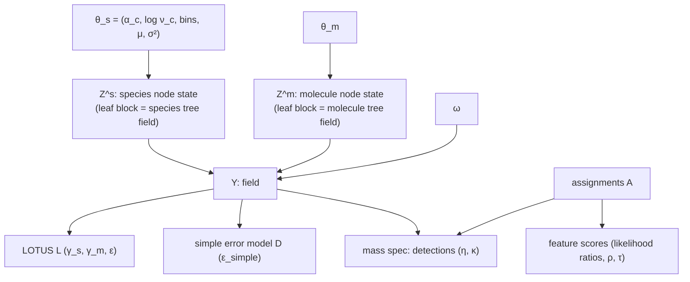

# How the model changed since the SNSF grant

This note compares the model in the grant's research plan (`docs/manuscript/main/main.tex`, chapter "Random Markov Field", and `docs/manuscript/supplementary/supplementary.tex`) with the model the code implements at commit `15e3dbf` (2026-11-04). The changes are traced through the ADRs in `docs/adr/`, the vocabulary in `GLOSSARY.md`, and the source in `src/`.

Every claim about the current model points to an ADR or a source file. Where the repository gives no reason for a change, this note says so, and any reasoning added here is marked **[inference]**.

---

## 1. Summary

| Aspect | Grant | Now | Where |
|---|---|---|---|
| Dimensions | $D \ge 2$ (NP, species, tissue, …), NP first | Exactly two trees, species first, molecules second | `NUMBER_OF_TREES == 2`; commits `0b04ffe`, `9fca179` |
| Leaf-level variables | One shared set $\mathcal{Y}$, a leaf of every clique of both trees | Each tree has its own leaf-level **tree field** ($Z^s$, $Z^m$). The **field** $Y$ is a noisy AND of the two | ADR-0002, ADR-0005 |
| Joint density | $\prod_d \prod_{c\in\mathcal{C}_d}\phi(c)$, not normalised | A directed factorisation with normalising constant exactly 1 | ADR-0005 |
| New parameter | none | $\omega$, the tree-field error probability, in $(0, 0.5)$ | ADR-0005 |
| Tree process | Two-state CTMC, per-clique $\alpha_c$, $\nu_c$, matrix exponential | Same process, closed-form $e^{\Lambda t}$, hierarchical prior on $\log\nu_c$ | ADR-0003, `docs/model_notes/model.tex` |
| Branch lengths | $\sum_n b(n)=1$; grid on $[0, 0.1]$, $K=100$ | Mean branch length $=1$; grid $\delta(k+\tfrac12)$, $\delta = 2/(K+1)$, default $K=10$ | `TBinGrid.h` |
| Rate discretisation | Precompute a grid of rate values | Not done. The closed form, and transition counts, make it unnecessary | ADR-0003, ADR-0016 |
| LOTUS | $R_{ms}=(1-e^{-\gamma_0P_m})(1-e^{-\gamma_1Q_s})$, raw paper counts | Same form on $\log(1+\text{count})$; proper Gamma prior on each $\gamma$, Beta prior on $\epsilon$ | `TLotusMath.h`, `Types.h` |
| Collapse over extra dimensions | $x(m,s)=\min(1,\sum\cdots)$ | Removed: LOTUS is indexed on both trees | ADR-0005 |
| Mass spectrometry | Simulate a profile with ViMMS, compare **MEMO vectors**, error $\epsilon$ | Per-feature candidate structures scored by a **likelihood ratio**, latent **assignments**, filter and contamination probabilities | ADR-0012 → ADR-0018 → ADR-0020 |
| Diagnostic data | none | **Simple error model** $D$, rate $\epsilon_{\text{simple}}$ | `src/simple_error_model/` |
| Sampler | "MCMC" | Eight-state block update at each leaf pair; Gibbs walk on internal nodes; Metropolis moves on parameters and assignments | ADR-0005, ADR-0010, ADR-0019 |

---

## 2. Notation

The grant writes $\nu(c)$ for a clique's *variable dimension* and $\nu_c$ for its *rate*, and flags the clash itself ("TODO: change $\nu(c)$ for something else"). This note keeps $\nu_c$ for the rate only.

| Grant | Here / code | Meaning |
|---|---|---|
| $\mathcal{T}_d$, $d=1..D$ | $T_s$ (species), $T_m$ (molecules) | the trees |
| $\mathcal{E}_d$ | $S$ species leaves, $M$ molecule leaves | leaves |
| $\mathcal{Y}$ | $Y \in \{0,1\}^{S\times M}$ (**field**) | presence at a leaf pair |
| $\mathcal{Z}$ (internal nodes only) | $Z^s \in \{0,1\}^{N_s\times M}$, $Z^m\in\{0,1\}^{S\times N_m}$ (**node states**, leaves included) | latent state of every node |
| — | $Z^s_{ij}$, $Z^m_{ij}$ with $i,j$ leaves (**tree fields**) | each tree's own view of the leaf level |
| $\alpha_c$, $\nu_c$ | `<tree>_alpha`, `<tree>_log_nu` | per-clique stationary frequency and switching rate |
| $b(n)$ | bin $k(n)$ | branch length, discretised |
| — | $\omega$ (`omega`) | tree-field error probability |
| $\gamma_0,\gamma_1$, $\epsilon$, $R_{ms}$ | $\gamma_s,\gamma_m$, $\epsilon$ (`epsilon`), $R_{ij}$ | LOTUS detection rates, false-record rate, research effort |
| $\mathcal{D}_i$, $\bm{\xi}_i$, $\mathcal{M}(\cdot)$, $\epsilon$ | runs, features, assignments $A$, $\eta_{km}$, $\kappa$, $\rho$, $\tau$ | mass spectrometry, see §6 |

A **clique** keeps the grant's meaning. A species-tree clique is a column $j$ of $Z^s$: every node of $T_s$, with molecule leaf $j$ fixed. A molecule-tree clique is a row $i$ of $Z^m$. Clique space is row-major (ADR-0011).

---

## 3. The tree process: what stayed

The process along each tree is the grant's. For a clique $c$ with $\alpha_c\in(0,1)$ and $\nu_c>0$:

$$
\Lambda_c=\nu_c\begin{pmatrix}-\alpha_c & \alpha_c\\ 1-\alpha_c & -(1-\alpha_c)\end{pmatrix},
\qquad
P_c(t)=\Pi_c+(I-\Pi_c)\,e^{-\nu_c t},
$$

where every row of $\Pi_c$ is $(1-\alpha_c,\ \alpha_c)$. A root is drawn from that stationary distribution. A tree may have several roots.

What changed around the process:

- **Closed-form exponential.** A two-state generator has eigenvalues $0$ and $-\nu_c$, so $e^{\Lambda_c t}$ needs one scalar exponential. The code evaluates it at $\delta/2$ and $\delta$ only, and reaches the other bins by $P^{(k)}=P^{(k-1)}P^{(\delta)}$. This is the supplementary's recursion, kept on purpose: the independent Python reference evaluates every bin directly, so the two implementations stay independent (ADR-0003).
- **Branch-length constraint.** The supplementary fixes $\sum_n b(n)=1$ on a grid over $[0, 0.1]$ with $K=100$. The code fixes the **mean** grid branch length to 1 (commit `ff782c2`). Bin $k$ stands for length $\delta(k+\tfrac12)$ with $\delta=2/(K+1)$. The bins of a tree always sum to the **branch-length budget** $n_{\text{branches}}K/2$. The supplementary's paired $\pm1$ moves keep that sum. The default is $K=10$ (`--n_bins`).
- **Rate discretisation** (supplementary §"Discretization of rate parameters") was not built. Instead, the $\alpha$ and $\nu$ moves score a clique from its $4K+2$ transition counts (ADR-0016).
- **Priors.** $\alpha_c\sim U(0,1)$. $\log\nu_c\sim\mathcal{N}(\mu_{\log\nu},\sigma^2_{\log\nu})$, with $\mu_{\log\nu}$ (uniform prior) and $\sigma^2_{\log\nu}$ (fixed Gamma prior, `1,2`) inferred per tree. Branch bins have a uniform prior (`src/Types.h`, `src/TCore.cpp`). The grant names no priors.
- **Identifiability.** Only $\nu_c t$ enters $P_c$, so $\nu$ is identified only through the branch-length budget (`docs/model_notes/model.tex`, §Identifiability).

---

## 4. The field: the central change

### 4.1 Grant: one shared leaf layer

In the grant, $\mathcal{X}=\mathcal{Y}\cup\mathcal{Z}$. Each $y\in\mathcal{Y}$ belongs to one clique of **every** tree, and

$$P(\mathcal{X})=\prod_{d=1}^{D}\prod_{c\in\mathcal{C}_d}\phi(c).$$

Each $\phi(c)$ is a normalised tree likelihood. Their product is not normalised, because both trees' factors depend on the same $Y$:

$$
\sum_{Y,Z^s,Z^m}p_s(Y,Z^s\mid\theta_s)\,p_m(Y,Z^m\mid\theta_m)=\sum_Y p_s(Y)\,p_m(Y)=C(\theta_s,\theta_m)\neq 1.
$$

$C$ moves with the parameters and is a sum over $2^{SM}$ fields. Scoring the $\alpha$ and $\nu$ moves on the product alone samples $p(\theta)\,C(\theta)$, and $C$ grows as $\nu$ falls. Measured results (ADR-0002; `docs/model_notes/model.tex` §2):

- With the molecule tree neutral, $C$ is constant and the bias is zero. Away from neutrality the optimum of $\log\nu$ sits 0.58 below the truth on a 2×2 field and 1.38 below on a 4×4 one.
- On larger runs, $\log\nu\to-18$, $Y$ froze at all zeros, and the error rates absorbed the whole data set. Priors cannot stop this: the field term gained about $5.6\times10^4$ log units.

### 4.2 Interim fixes (superseded)

Before ADR-0005, `docs/model_notes/model.tex` records a maximum pseudo-likelihood scheme ("Phase 1": internal nodes; "Phase 2": leaf conditionals) and an exact block draw of $Z$. These are no longer in `src/`. Read those sections of `model.tex` as history.

### 4.3 Now: each tree owns its leaf level, and the field reconciles them (ADR-0005)

Each tree's node state extends down to its own leaves. Its leaf block is that tree's **tree field**. The field $Y$ is no longer a variable the trees share. It is drawn from the two tree fields:

$$
p(Z^s\mid\theta_s)\;p(Z^m\mid\theta_m)\;p(Y\mid Z^s,Z^m,\omega)\;p(\text{data}\mid Y,\ldots).
$$

Every factor is a proper conditional density, and no variable is conditioned on its own descendants. The joint therefore sums to 1 for every parameter value: $C\equiv1$. The Markov blanket of $\theta_s$ is $Z^s$ alone, so the $\alpha$ and $\nu$ moves read one tree.

**The link is a noisy AND.** Each tree-field cell is corrupted independently with probability $\omega$, and $Y$ is the AND of the two corrupted cells:

| $Z^s$ | $Z^m$ | $P(Y=1\mid Z^s,Z^m)$ |
|---|---|---|
| 1 | 1 | $(1-\omega)^2$ |
| 1 | 0 | $(1-\omega)\,\omega$ |
| 0 | 1 | $\omega\,(1-\omega)$ |
| 0 | 0 | $\omega^2$ |

The AND is a modelling choice: a molecule occurs in a species only when both phylogenies allow it, so $Y$ is sparser than either tree field. It sits behind a link-policy seam and can be replaced without revisiting the normalisation argument (ADR-0005, derivation 1).

Consequences of the link (ADR-0005, derivations 2 and 3):

- **$\omega\in(0,0.5)$.** At 0 the link is deterministic. Above 0.5 the tree fields are anti-correlated with $Y$.
- **Six counters.** The table depends on $(Z^s,Z^m)$ only through $k=Z^s+Z^m$. The link likelihood is therefore a function of $\omega$ and six integers $n(k,y)$, and the $\omega$ move costs O(1).
- **Two diagnostics hold for every $\omega$:** $P_1^2=P_0P_2$, and $\sqrt{P_0}+\sqrt{P_2}=1$. The second fails if the trees have different error probabilities. Both are traced, not tested.
- **A ridge.** $P(Y=1)=\tilde a_s\tilde a_m$ with $\tilde a=\omega+(1-2\omega)\alpha$. The overall density of $Y$ cannot split the rate between the trees. Only phylogenetic covariation can. This is an identifiability limit, not a bias.

### 4.4 New variables

| Variable | Size | Prior / support | Moves |
|---|---|---|---|
| Species tree field $Z^s_{ij}$ ($i$ a species leaf) | $S\times M$ | via the species tree process | block update |
| Molecule tree field $Z^m_{ij}$ ($j$ a molecule leaf) | $S\times M$ | via the molecule tree process | block update |
| Node states at internal nodes | $(N_s-S)\times M$, $S\times(N_m-M)$ | tree process | Gibbs walk per clique |
| $\omega$ | scalar | exponential, rate 200 (mean 0.005), truncated to $(0,0.5)$ (`--error_probability_prior_rate`) | Metropolis on the six link counters |

Outputs added with them: the posterior of each tree field (`--write_tree_field_posteriors`), the link-counter trace, and the joint density $\log p(Z^s)+\log p(Z^m)+\log p(Y\mid Z^s,Z^m,\omega)+\log p(\text{data}\mid Y)$, which is now a proper density and serves as a drift monitor.

---

## 5. The sampler

The grant says only "MCMC". One iteration now runs, in order (GLOSSARY "Update"):

1. Metropolis moves on $\omega$ and the data-source parameters ($\gamma_s,\gamma_m,\epsilon$; $\epsilon_{\text{simple}}$; $\eta$, $\kappa$).
2. **Block update.** At each leaf pair, $(Y_{ij},Z^s_{ij},Z^m_{ij})$ is drawn jointly from its 8 states:
   $$\propto P^s_j(t_i)_{Z^s_{\mathrm{pa}(i)j},\,z_s}\;P^m_i(t_j)_{Z^m_{i\,\mathrm{pa}(j)},\,z_m}\;P(y\mid z_s,z_m,\omega)\;\prod_{\text{sources}}P(\text{obs}_{ij}\mid y).$$
   With small $\omega$, one-variable-at-a-time draws are metastable: $Y=1$ pins both tree fields to 1. ADR-0008 tried single-variable updates. ADR-0010 brought the block back: without it the field's density decorrelates 4.7× slower at $\omega=0.005$.
3. Species tree update: Gibbs walk over internal nodes, then the $\alpha$, $\nu$ and branch-length moves.
4. Molecule tree update, likewise.
5. Mass-spectrometry assignment moves (§6.5).

The block update needs every data source to factorise over cells. That is why the grant's collapse over extra dimensions was removed (ADR-0005), and why mass spectrometry enters only **conditional on its assignments** (§6.4).

**Holding variables** (ADR-0019). `--fix_Y` holds $Y$ alone. `--fix_Z` holds both node states, leaves included. The block draws whatever is left, given what is held. Before this fix, holding $Y$ also froze both tree fields at $Y$. That biased $\alpha$ by about −0.27 in the validation rung (issue #106).

**Chain start.** Both tree fields are 1 wherever a LOTUS record exists and 0 elsewhere. $Y$ starts equal to them, and internal nodes are set from their children.

**Sufficient statistics** (computational, the model is unchanged): LOTUS present-cell counts by paper-count class (ADR-0015), per-clique transition counts (ADR-0016), and one pass per data source through the block update (ADR-0017). Each cell's random number is hashed from its position, so runs reproduce at any thread count (ADR-0007).

---

## 6. Mass spectrometry: from MEMO vectors to likelihood ratios

### 6.1 What the grant proposed

For a sample $\mathcal{D}_i$ that represents a leaf vector $\bm\xi_i$ (species, tissue, …), take the slice $\bm{x}(\bm\xi_i)$ of presences over all NPs. Simulate a theoretical profile $\mathcal{D}'_i$ with an NP-flavoured ViMMS, fed by ISDB-LOTUS and expert priors on losses during extraction, LC and fragmentation. Turn both profiles into **MEMO vectors** (Spec2Vec words aggregated per sample), and compare $\mathcal{M}(\mathcal{D}'_i)$ with $\mathcal{M}(\mathcal{D}_i)$ under a per-entry error rate $\epsilon$.

### 6.2 What replaced it

None of that is in the code: no ViMMS, no MEMO, no Spec2Vec. The observation is now the **annotation** of each feature, not a sample-level fingerprint. The vocabulary below is the glossary's.

| Term | Meaning |
|---|---|
| **Extract** | one physical sample of one species, prepared by one protocol |
| **Run** $r$ | one LC-MS/MS acquisition of one extract, belonging to species $s(r)$ |
| **Filter** $k(r)$ | the extraction protocol of the run. It decides which molecules can be detected. The file has no filter column yet, so every run gets one shared filter (`mass_spec_file.h`) |
| **Feature** $f$ | one signal a run detected, unique within the run |
| **Proposed structure** $j$ | one structure listed for $f$ with its scores. Comes from the `feature-probabilities` export (`inference_lotus/ms_prep.py`) |
| **Candidate** | a proposed structure that is a molecule leaf |
| **Outside structure** | a proposed structure that is not a molecule leaf. It has no cell in $Y$ |
| **Unknown molecule** $U$ | "no candidate": a molecule outside the tree, or no molecule |
| **Assignment** $A_{rf}$ | the latent candidate or $U$ that explains $f$. Within a run a molecule explains at most one feature |
| **Detected** $d_{rm}$ | $1$ iff some feature of run $r$ is assigned to molecule $m$ |

Each proposed structure carries two densities over (CSI:FingerID score, ion mass), fitted upstream in `feature-probabilities`: $g_1$ among correct identifications and $g_0$ among incorrect ones. The model reads only their ratio, the **likelihood ratio** $\Lambda_j=g_1(x_j)/g_0(x_j)$.

### 6.3 The likelihood

For run $r$ of species $s$ with filter $k$:

$$
p(\text{scores}_r,\,A_r\mid Y,\eta,\kappa)\;\propto\;
\underbrace{\prod_{f\in r} w_f(A_{rf})}_{\text{feature terms}}\;
\underbrace{\prod_{m=1}^{M}P(d_{rm}\mid Y_{sm})}_{\text{detection terms}},
$$

$$
P(d=1\mid Y=1)=\eta_{km}\ (\text{filter probability}),\qquad P(d=1\mid Y=0)=\kappa\ (\text{contamination probability}),
$$

$$
w_f(m)=\Lambda_{fm}\ \text{for a candidate } m,\qquad
w_f(U)=W_{U,f}=\rho\,n_f\;+\;\tau\!\!\sum_{j\in\text{outside}(f)}\!\!\Lambda_j .
$$

Here $n_f$ is the number of proposed structures of $f$, outside ones included. $\rho$ is the **unknown rate** (`--ms_unknown_rate`, required, no default) and $\tau$ the **outside rate**.

Why this form (ADR-0018): suppose the true structure sits among the proposed ones like any other row, and rows are independent given the truth. Then $P(A=m\mid x)\propto\pi_m\,\frac{g_1(x_m)}{g_0(x_m)}\prod_j g_0(x_j)$ and $P(A=U\mid x)\propto\pi_U\prod_j g_0(x_j)$. The shared product cancels. If proposed structures are drawn uniformly from $M$, the odds of $U$ grow linearly with $n_f$. On 73,768 held-out ground-truth features this weighting raised top-1 accuracy from 0.358 to 0.496 and lowered log-loss from 2.04 to 1.55, compared with the previous best-row weighting.

Read as a single move, sending feature $f$ from $U$ to candidate $m$ multiplies the density by

$$
\frac{\Lambda_{fm}}{W_{U,f}}\times
\begin{cases}\eta_{km}/(1-\eta_{km}) & Y_{sm}=1\\ \kappa/(1-\kappa) & Y_{sm}=0\end{cases}
$$

That is the likelihood ratio times the candidate's **detection odds** (`msms_data.cpp`, `calculate_LL_ratio_for_assignment_move`). $\tau$ is the outside-structure counterpart of those detection odds, for a molecule with no cell in $Y$ (ADR-0020).

**Binning.** Within each feature, every weight is stored as an 8-bit bin $b=\mathrm{round}(16(\ln w_{\max,f}-\ln w))$, i.e. on a 1/16-nat grid below the feature's largest weight, the unknown weight included. Weights more than $255/16$ nats below the maximum are clamped. Every move compares weights within one feature, so the per-feature offset cancels (ADR-0012 grid, kept by ADR-0018).

### 6.4 How it reaches the field

Given $A$, mass spectrometry factorises over cells. The cell $(s,m)$ gets

$$
\Big(\prod_{r\in s}P(d_{rm}\mid Y=0),\ \prod_{r\in s}P(d_{rm}\mid Y=1)\Big),
$$

and $(1,1)$ for a species without runs. This pair is multiplied into the block update's cell data factor like the LOTUS and simple-error-model factors (`TMassSpecMath.h`, `per_cell_factor`). The feature terms do not involve $Y$, $\eta$ or $\kappa$, so they cancel from field draws and from the filter moves.

### 6.5 New variables and parameters

| Symbol | Code | Size | Prior / status |
|---|---|---|---|
| $A_{rf}$ | `TMassSpecRun::_current_assignments` | one per feature | latent. Metropolis–Hastings with five move types (to $U$, from $U$, swap, move to a free candidate, swap with $U$). `--ms_proba_move_to_unknown` $\beta$ (default 0.1) is the probability of proposing a return to $U$. Features are drawn at random; visiting them in order biases the stationary distribution (`msms_run.cpp`). Starts at $U$ |
| $\eta_{km}$ | `filter_proba` | filters × molecule leaves | grid $i/255$, $i\in\{0,\ldots,254\}$, uniform prior, starts at $128/255$ |
| $\kappa$ | `contamination_proba` | scalar | Beta(0.3, 5), starts at 0.001 |
| $\rho$ | `--ms_unknown_rate` | scalar | **input**, not estimated (ADR-0018). Source: a fit on held-out ground truth, which is a lower bound |
| $\tau$ | `--ms_outside_rate` | scalar | **input**, not estimated (ADR-0020). Required with `--ms_data`, no default, finite and $\ge 0$. Plug-in value from a pilot run, checked against $\{0.01, 0.1, 1\}$ |

Output: `--write_assignment_posterior` writes, for each feature, the fraction of iterations it spent on each candidate and on $U$. ADR-0020 splits $U$'s share across outside structures plus a remainder under `<unlisted>`; the output does not do this yet (#115).

### 6.6 How the unknown weight evolved

| Step | Candidate weight | Unknown weight | Why it changed |
|---|---|---|---|
| June 2026 (`605e2a8`) | "PHRED-like" binned probability | — | first implementation |
| ADR-0012 (2026-10-15) | correct density divided by the feature's best row | fixed fraction $c=0.1$ | only one density (correct) was available |
| ADR-0018 (2026-11-02) | $\Lambda=g_1/g_0$ | $\rho\,n_f$ | best-row division is exact only if $g_0$ is flat. It is not, and the held-out evaluation confirmed it |
| ADR-0020 (2026-11-04) | $\Lambda$ | $\rho\,n_f+\tau\sum_{\text{outside}}\Lambda_j$ | in the real export 82% of proposed structures are outside structures, and 73% of features have an outside structure as their best match |

### 6.7 Why not MEMO

No ADR or commit records the decision to drop the ViMMS + MEMO route. What the repository does record is the constraint the new route satisfies: the block update needs each data source to answer per cell, $\{P(\text{obs}\mid Y=0),P(\text{obs}\mid Y=1)\}$ (ADR-0005, ADR-0017; GLOSSARY "Data source"). **[inference]** A sample-level MEMO comparison would score a whole slice $\bm{x}(\bm\xi_i)$ at once, so it would not factorise over molecules and could not enter the block update. It would also need a forward simulator inside every likelihood evaluation. The grant's ingredients map onto the new model as follows:

| Grant ingredient | Current counterpart |
|---|---|
| ViMMS losses during extraction / LC / fragmentation | filter probability $\eta_{km}$ per (protocol, molecule) |
| MEMO per-entry error $\epsilon$ | contamination $\kappa$, plus the unknown molecule absorbing unexplained features |
| ISDB-LOTUS in-silico spectra | CSI:FingerID candidate lists, calibrated to $g_1/g_0$ upstream |
| Sample vector $\bm\xi_i$ (species, tissue, …) | run = (species, extract). Extract is not a tree dimension |

---

## 7. LOTUS: mostly as in the grant

$$
P(L_{ij}=1\mid Y_{ij}=1)=R_{ij},\qquad P(L_{ij}=1\mid Y_{ij}=0)=\epsilon,
$$

$$
R_{ij}=\big(1-e^{-\gamma_s\,o_i}\big)\big(1-e^{-\gamma_m\,o_j}\big),\qquad o=\log(1+\text{paper count}).
$$

Note that $1-e^{-\gamma\log(1+c)}=1-(1+c)^{-\gamma}$.

Changes:

- **Transform of paper counts.** The grant uses raw counts $P_m$, $Q_s$. The code switched to $\sqrt{\text{count}}$ (commit `1de0bd3`, 2025-11-24) and then to $\log(1+\text{count})$ (commit `6e58fe9`, 2026-05-27). A leaf with no papers has $R=0$, so its pairs are never reported.
- **One $\gamma$ per tree.** This matches the grant's $\gamma_0,\gamma_1$. The grant's sentence "positive scalars $\gamma$ and $\delta$" is a typo. The independent Python reference simulates with one shared $\gamma$, which is a special case.
- **Proper priors** (latest commits). $\gamma\sim\text{Gamma}(\text{shape},\text{rate})$, default Gamma(1,1), via `--gamma_prior_parameters`. A flat prior put infinite mass on the plateau where $R\approx1$ (above about $\gamma=10$), and with a free $Y$ the chain drifted there (#114). $\epsilon\sim\text{Beta}(a,b)$, default Beta(1,1), via `--epsilon_prior_parameters`. With a free $Y$, LOTUS alone does not separate $\epsilon$ from $\omega$, so the prior decides (#113).
- **No collapse.** The grant's $x(m,s)=\min(1,\sum\cdots)$ over extra dimensions, and the collapser that implemented it, were deleted (ADR-0005).

## 8. Simple error model (new)

$D_{ij}$ reports $Y_{ij}$, flipped independently with probability $\epsilon_{\text{simple}}$ (uniform prior). It is dense, it exists to validate and diagnose the rest of the model, and its move reads one disagreement count (`src/simple_error_model/`). Which of LOTUS, simple error model and mass spectrometry are present is chosen at compile time (cmake preset letters `l`, `s`, `m`).

---

## 9. Validation

The grant does not mention validation. The repository now has:

- An **independent Python reference** (`model_validation/simulate_independent.py`) that simulates the model by its own route, closed form per bin (ADR-0003). It now has LOTUS + MS scenarios, dense and sparse (`b8dea73`).
- A **rung ladder**: rung 1 pins the field and both node states, rung 2 pins the field only, rung 3 is free. Coverage gates on $\alpha$, $\log\nu$ and the cliques are scored by `validate_independent.py`, and recovery of the field, detection and assignment by the validator (`7a667fe`, `db0e76b`).
- **Neutralising** one tree (ADR-0001) is kept as a cheap regression rung. It is no longer the primary check, because a neutral tree carries no information about $\omega$ (ADR-0005, derivation 3).

---

## 10. Open items

- ADR-0020 (outside structures in $W_{U,f}$) is in the loader. The assignment posterior still writes $U$ as one row, without the outside rows and `<unlisted>` (#115).
- $\rho$ and $\tau$ are inputs. Estimating them is deferred.
- Outside structures are exempt from "one molecule per feature per run". This misspecification is accepted (ADR-0020).
- Only one filter is loaded. Per-protocol $\eta_{km}$ exists in the parameter layout, but the file format cannot express it yet.
- Known weakly identified directions: $\alpha_s$ vs $\alpha_m$ vs $\omega$ (ridge), $\omega$ vs $\epsilon$ (#113), the $\gamma$ plateau (#114), and per-clique $\nu$ (SE ≈ 0.5 at 254 branches; `model.tex` §Identifiability).
- The grant's $D>2$ (tissue, environment) is not supported. Data indexed on only some dimensions needs its own model decision (ADR-0005).

## 11. Sources that disagree with the code

- `docs/model_notes/model.tex` §§3–6 (pseudo-likelihood, $Z$-only block, `--single_site_Z`, `--no_leaf_pseudo_likelihood`) describe the model before ADR-0005. None of it is in `src/`.
- The `src/cli.h` comment on `ERROR_PROBABILITY_PRIOR_RATE` says "a rate of 20 puts the prior mean at 0.05". The default is 200 (mean 0.005), which `src/Types.h` states correctly.
- `inference_lotus/feature_molecule_scores.csv` (untracked) still has the old `calibration_score` column, which ADR-0018 replaced with the two log densities.

## 12. ADR index

| ADR | Date | Kind | Decision |
|---|---|---|---|
| 0001 | 08-24 | validation | Neutral molecule tree for a single-tree reference (superseded by 0005) |
| 0002 | 08-25 | **model** | Diagnosis: the two-tree product is unnormalised, which biases $\nu$ downward |
| 0003 | 08-25 | numerics | Transition grid by recursion, closed form only at two bases |
| 0004 | 08-27 | code | Canonical node order: leaves, internal, roots |
| 0005 | 08-31 | **model** | Tree fields + noisy-AND link with $\omega$, $C\equiv1$ |
| 0006 | 09-01 | code | Per-storage traversal (superseded by 0009) |
| 0007 | 09-01 | sampler | Per-cell hashed uniforms |
| 0008 | 09-10 | sampler | Single-variable leaf layer (decision superseded by 0010) |
| 0009 | 09-10 | code | Storages addressed by cell handle |
| 0010 | 09-10 | sampler | Eight-state block update reinstated |
| 0011 | 09-10 | code | Clique space is row-major |
| 0012 | 10-15 | **model (MS)** | Scores relative to the feature's best row (superseded by 0018) |
| 0013 | 10-21 | perf | Node-state cliques contiguous |
| 0014 | 10-21 | perf | Depth-first leaf numbering |
| 0015 | 10-21 | perf | LOTUS likelihood from present-cell counts |
| 0016 | 10-22 | perf | $\alpha$/$\nu$ moves from transition counts |
| 0017 | 10-22 | code | Each data source has its own block-update pass |
| 0018 | 11-02 | **model (MS)** | Candidates by likelihood ratio, unknown weight $\rho\,n_f$ |
| 0019 | 11-03 | sampler | Holding a variable conditions the block on it |
| 0020 | 11-04 | **model (MS)** | Outside structures add $\tau\sum\Lambda_j$ to the unknown weight |
